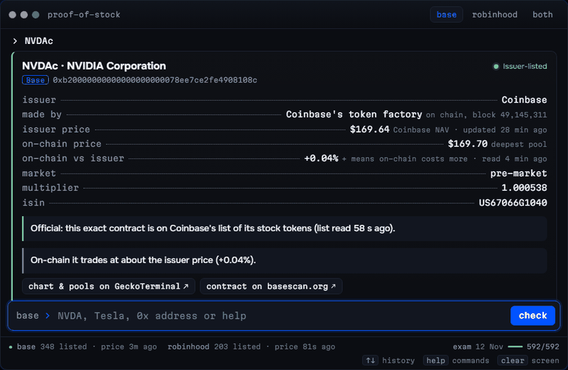
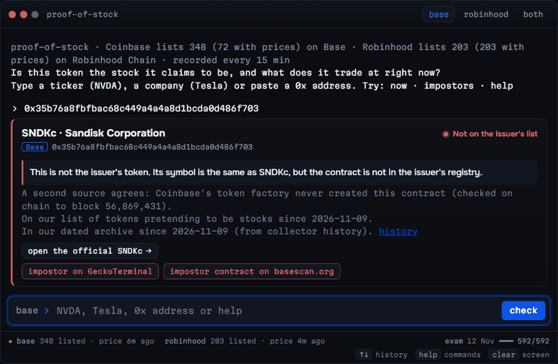
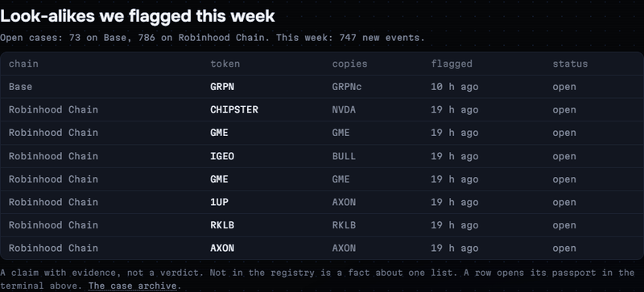
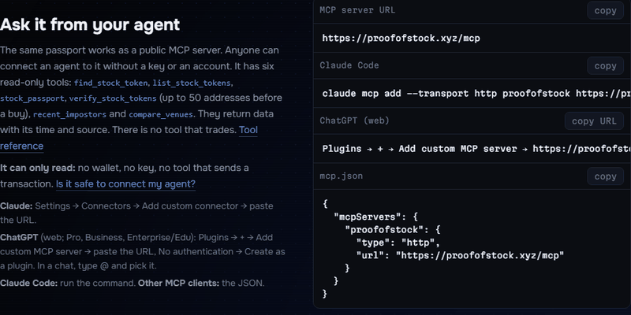
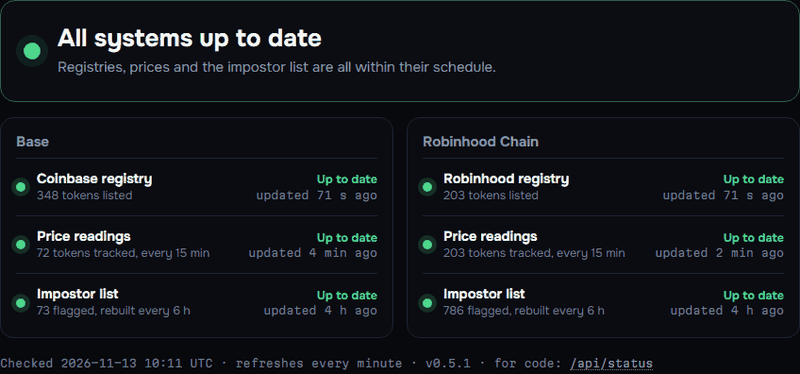

# Proof of Stock™

[](https://github.com/proofofstock/proof-of-stock/actions/workflows/ci.yml)
[](LICENSE)
[](https://github.com/proofofstock/proof-of-stock/tree/exam)
[](https://glama.ai/mcp/connectors/xyz.proofofstock/proof-of-stock)
[](https://scorecard.dev/viewer/?uri=github.com/proofofstock/proof-of-stock)

## At a glance

Anyone can deploy a token called "NVIDIA" in a minute, and look-alikes of the issuers' stock tokens keep appearing
on the same chains. An agent that buys by name buys whichever it finds first. The live list of the ones we flagged is at
[proofofstock.xyz/history](https://proofofstock.xyz/history).

**Is this stock token the real one?** Paste an address or a ticker; we check it against the issuer's own list on Base
(Coinbase) and Robinhood Chain (Robinhood). Tokenized stocks are a kind of real-world asset (RWA); we check stocks only,
not bonds, funds or commodities.

We are a centralised service, and that is why every claim here comes with a way to check it without us. The chain is
not here so that we can be trusted: it is here so that we cannot rewrite yesterday.

**Check us first:** every day a public exam asks the live service every token on both issuers' lists plus the week's
look-alikes, and grades the answers against the issuers' own data. The reports are in the
[`exam` branch](https://github.com/proofofstock/proof-of-stock/tree/exam).

<details>
<summary><b>Build log</b>: what shipped when</summary>

The code is developed in a private repository and exported here at each release, so this repository's own history is
short. The dated record is [CHANGELOG.md](CHANGELOG.md); in one line per release:

| Date | Release | What shipped |
|---|---|---|
| 2026-11-08 | 0.1.0 | The passport, the price recorder (every 15 minutes), the impostor list and the public site |
| 2026-11-10 | 0.2.0 | `/verify`, the embeddable badge, MCP `verify_stock_tokens` and `recent_impostors`, the agent guard with an AgentKit action |
| 2026-11-10 | 0.3.0 | Documentation at `/docs/`, `/llms.txt`, the Base ↔ Robinhood premium matrix |
| 2026-11-11 | 0.4.0 | The case archive; the guard trusts only a well-formed answer |
| 2026-11-11 | 0.5.0 | The source is public (this repository) |
| 2026-11-12 | 0.5.1 | The public exam on the landing page; descriptions for every MCP tool argument |
| 2026-11-14 | 0.6.0 | A written threat model; the guard published through CI, not from a laptop |
| 2026-11-15 | 0.7.0 | Paid passes over the free rate, paid in USDC on Base over x402 |
| 2026-11-20 | 0.8.0 | Payment alarms reach Telegram; look-alikes found by symbol search across DEX aggregators |
| 2026-11-24 | 0.9.0 | Ten MCP tools; a Telegram bot, @ProofofStockBot; `/api`, every call with its price; tabs on every page; a badge to embed from each passport; paid passes over x402 v2 too; a Bankr skill in review |
| 2026-11-27 | Unreleased | List locks: a listed record needs the issuer's factory on chain; a kill switch off our host; `/tokenlist.json` and `/denylist.json`; the agent test; pool depth on every passport; the Demo Agent at `/demo` |

</details>

<table>
  <tr>
    <td width="50%"><a href="https://proofofstock.xyz/?base=NVDAc"></a><br><b>A token passport.</b> NVDAc on Base, on Coinbase's list.</td>
    <td width="50%"><a href="https://proofofstock.xyz/?chain=base&amp;address=0x35b76a8fbfbac68c449a4a4a8d1bcda0d486f703"></a><br><b>An impostor.</b> Calls itself SNDKc; not on the issuer's list.</td>
  </tr>
  <tr>
    <td><a href="https://proofofstock.xyz/history"></a><br><b>Look-alikes flagged.</b> The weekly list; the archive is at <a href="https://proofofstock.xyz/history">/history</a>.</td>
    <td><a href="https://proofofstock.xyz/#mcp"></a><br><b>Ask it from your agent.</b> A public MCP server, no key.</td>
  </tr>
  <tr>
    <td><a href="https://proofofstock.xyz/status"></a><br><b>Status.</b> How fresh each registry, price and list is.</td>
    <td>
      <b>Links</b><br>
      <a href="https://proofofstock.xyz">Site</a> ·
      <a href="https://proofofstock.xyz/?base=NVDAc">Passport</a> ·
      <a href="https://proofofstock.xyz/verify?chain=base&amp;address=0x35b76a8fbfbac68c449a4a4a8d1bcda0d486f703">/verify</a> ·
      <a href="https://proofofstock.xyz/history">/history</a> ·
      <a href="https://proofofstock.xyz/status">/status</a> ·
      <a href="https://proofofstock.xyz/anchors">/anchors</a> ·
      <a href="https://proofofstock.xyz/api">/api</a> ·
      <a href="https://proofofstock.xyz/tokenlist.json">/tokenlist.json</a> ·
      <a href="https://proofofstock.xyz/denylist.json">/denylist.json</a> ·
      <a href="https://proofofstock.xyz/agent-test">/agent-test</a> ·
      <a href="https://proofofstock.xyz/demo">/demo</a> ·
      <a href="https://proofofstock.xyz/docs/">Docs</a><br><br>
      <b>MCP</b> <code>https://proofofstock.xyz/mcp</code><br>
      <b>MCP registry</b> <a href="https://registry.modelcontextprotocol.io/v0/servers?search=xyz.proofofstock"><code>xyz.proofofstock/proof-of-stock</code></a><br><br>
      <b>Contact</b> <a href="mailto:hello@proofofstock.xyz">hello@proofofstock.xyz</a>
    </td>
  </tr>
</table>

Proof of Stock tells you whether a tokenized-stock contract is the issuer's own. It looks the exact address up in the
issuer's registry: Coinbase's for Base, Robinhood's for Robinhood Chain. A name or a symbol proves nothing, so tokens
that copy a listed symbol are flagged and pointed at the listed contract.

For a listed token it also shows the issuer's price, how old that price is, and how far the deepest on-chain pool
trades from it.

It is for:

- **people buying stock tokens**, who want to check a contract before they buy;
- **agent builders**, whose agents need the same check before a swap.

Live at **[proofofstock.xyz](https://proofofstock.xyz)**. Documentation: [proofofstock.xyz/docs](https://proofofstock.xyz/docs/).

## Use it

No key and no sign-up for any of these, within the free limit.

| | |
|---|---|
| **Site** | [proofofstock.xyz](https://proofofstock.xyz): paste an address or type a ticker. |
| **Demo Agent** | [proofofstock.xyz/demo](https://proofofstock.xyz/demo): an agent searches the market for a stock by name, and Proof of Stock tells the original from the rest, live in the browser. Nothing is signed. |
| **Telegram bot** | [@ProofofStockBot](https://t.me/ProofofStockBot): send it a contract address for the verdict, or a ticker for the issuer's own contract. |
| **MCP server** | `https://proofofstock.xyz/mcp` (Streamable HTTP, stateless). Ten tools: `find_stock_token`, `list_stock_tokens`, `stock_passport`, `verify_stock_tokens`, `recent_impostors`, `compare_venues`, `verify_anchor`, `largest_gaps`, `data_freshness`, `address_on_date`. |
| **JSON API** | `GET /verify`, `GET /badge.svg`, `GET /api/passport` and more. Every route and tool with what it costs: [proofofstock.xyz/api](https://proofofstock.xyz/api). Reference: [HTTP API](docs/reference/http-api.md). |
| **Token list** | [`/tokenlist.json`](https://proofofstock.xyz/tokenlist.json): the issuer-listed tokens that trade in a pool, as a Uniswap token list for a wallet or DEX front end to import. Never an impostor. [Reference](docs/reference/http-api.md#route-tokenlist). |
| **Look-alike list** | [`/denylist.json`](https://proofofstock.xyz/denylist.json): every look-alike we flag right now, on both chains, in one file, for a wallet or security API to warn before a swap. Not a token list. [Reference](docs/reference/http-api.md#route-denylist). |
| **Agent test** | [proofofstock.xyz/agent-test](https://proofofstock.xyz/agent-test): `curl -sS -X POST https://proofofstock.xyz/api/agent-test` gives your agent six buying tasks, graded against the issuers' own lists, with a result page and a badge. Nothing is bought. [Test your agent](docs/how-to/test-your-agent.md). |
| **Guard** | `@proofofstock/guard`, a pre-trade check for Node agents, with a Coinbase AgentKit action. `npm install @proofofstock/guard`, no dependencies. It lives in [`packages/proofofstock-guard`](packages/proofofstock-guard/). |
| **Bankr skill** | `proof-of-stock`, the same check for Bankr agents, in review for Bankr's skill catalog ([the submission](https://github.com/BankrBot/skills/pull/860)). It lives in [`packages/bankr-skill`](packages/bankr-skill/). |
| **Past the free limit** | An agent can pay for itself: a short pass in USDC on Base over x402 (v1 or v2), no account. See [Pay per call](docs/how-to/pay-per-call.md). |

Add the MCP server to Claude Code:

```bash
claude mcp add --transport http proofofstock https://proofofstock.xyz/mcp
```

Claude, ChatGPT, Cursor and raw JSON-RPC are covered in the [tutorial](docs/tutorials/connect-an-agent.md).

## Check us, not just our answers

A checker is worth something only if you do not have to take its word. Each of these works without trusting us, and
[Check us](docs/how-to/check-us.md) puts them on one page, with the commands:

- **The list behind a verdict.** Every answer names the issuer list it was decided against by the SHA-256 of its
  sorted addresses, with a shell command that computes the same hash from the issuer's own API, and a URL of that
  exact list frozen.
- **A receipt to keep.** `/verify?...&receipt=1` returns a record of the check that
  [`scripts/receipt-check.mjs`](scripts/receipt-check.mjs) can check again months later, after the issuer's list has
  changed. See [Keep a receipt of a check](docs/how-to/keep-a-receipt.md).
- **The issuer's factory, read from the chain.** Each issuer creates its tokens from a factory that logs every one.
  We read those logs from finalized blocks (`issuer_factory` in each answer, with the block and the transaction), and
  a record on the issuer's list counts as listed only when that factory created it; on Base a second RPC must confirm
  it and the address must carry Coinbase's pinned prefix. A record the chain does not back is held with no verdict, so
  a verdict never rests on the issuer's HTTP list alone, and a new listing turns listed some minutes after its
  creation. Today's counts are on [the status page](https://proofofstock.xyz/status).
- **A kill switch off our host.** A Cloudflare Worker in the owner's own account compares our list with each issuer's
  own once a minute. If our server would call listed something the issuer does not list, it trips, and every verdict
  route answers `503` until the owner clears it ([`deployment/KILLSWITCH.md`](deployment/KILLSWITCH.md)).
- **A guard that checks the issuer itself.** From 0.3.0, `@proofofstock/guard` reads the issuer's own list beside our
  answer and pins the Base address prefix, so our answer alone can refuse a buy but cannot make one.
- **The agent test, checked without us.** A result's receipt is rechecked and replayed by
  [`scripts/agent-test-check.mjs`](scripts/agent-test-check.mjs): the frozen issuer lists against their hashes, the
  draw from the revealed secret, the grade again.
- **Prices you can replay.** An on-chain price carries its block and the exact call; `eth_call` at that block returns
  the same bytes.
- **A public exam, every day.** Every token on the issuers' lists, plus the week's look-alikes, strangers and tokens asked on the wrong chain: questions whose right answer comes from the issuers, not from us. The reports are in the
  [`exam` branch](https://github.com/proofofstock/proof-of-stock/tree/exam).
- **An outside check, a handful of times a day.** It runs on GitHub's own runners, not on our host: it hashes each issuer's
  list straight from the issuer against our `list_proof`, and calls a passport's on-chain price evidence again at its
  block for the same bytes ([`scripts/canary.mjs`](scripts/canary.mjs)).
- **History anchored in Bitcoin.** Once a day, a manifest of every data file of the day is timestamped through
  OpenTimestamps. See [Check that our data existed on a given day](docs/how-to/verify-an-anchor.md).

## Example

Check one address on Base. This one calls itself `SNDKc` but is not on Coinbase's registry:

```bash
curl -s 'https://proofofstock.xyz/verify?chain=base&address=0x35b76a8fbfbac68c449a4a4a8d1bcda0d486f703' \
  | jq '{listed, impostor, listed_on_other_chain, registry_age_s}'
```

```json
{
  "listed": false,
  "impostor": { "kinds": ["registry_symbol"], "imitates_symbol": "SNDKc", "listed_address": "0xb200000000000000000000397293cb8cda9a10c5" },
  "listed_on_other_chain": null,
  "registry_age_s": 112
}
```

`listed` is `true` only when this exact address is in the registry and the chain backs it: the issuer's factory
created it. `impostor.listed_address` is the contract the issuer actually lists. A `503` is no answer, not "not
listed": the registry could not be read, the chain does not back the record yet (its `reason` says why), or the kill
switch is tripped. More in
[Check a contract before listing or buying it](docs/how-to/check-before-listing.md).

## What it does not do

- **It only reads.** It never trades, has no accounts and no cookies, and holds no wallet of yours. It has two keys, both on our own server, each holding only gas. The anchor key writes our daily anchor hash to Base and Robinhood Chain, from its own address, value zero; nothing you send can make it sign. The settlement key exists only for [paid passes](docs/how-to/pay-per-call.md): it submits the USDC payment a buyer signed, exactly as signed, and can neither change the payee nor the amount; the payment goes to a separate wallet it does not control.
- **It is not advice.** An answer is a fact about data at a stated time. See [Legal](docs/legal.md).
- **"Not listed" is not "fake".** A genuine token of another issuer answers the same. Only Coinbase on Base and
  Robinhood on Robinhood Chain are checked.
- **It is not a live quote.** On-chain prices are recorded every 15 minutes, and every answer says how old it is.
- **It is not affiliated** with Coinbase or Robinhood. Their names and tickers are their trademarks.

How the answers are computed, and the known limits: [Methodology](docs/explanation/methodology.md).

## Run the tests

Node 20 or later.

```bash
npm install
npm test        # every suite, no network
npm run locks   # mutation locks: each breaks the code on purpose and needs a test to go red
```

To run the site locally, point it at the recorder's data and open `127.0.0.1:3005`:

```bash
STOCKS_ROOT_BASE=<dir> STOCKS_ROOT_ROBINHOOD=<dir> npm start
```

The recorder (`scripts/stocks/stock-peg.mjs --chain=base --root=<dir>`) needs outbound HTTPS to the issuer APIs,
DexScreener and GeckoTerminal.

## Layout

| Path | What |
|---|---|
| `evm/core/stocks/` | the logic, with no I/O: registries, impostors, premium, pool rules, NYSE calendar, passport, verify |
| `apps/` | the site, the JSON API and the MCP server |
| `packages/proofofstock-guard/` | the guard |
| `packages/bankr-skill/` | the Bankr skill, as submitted to Bankr's catalog |
| `scripts/stocks/` | the recorder (every 15 min), the impostor list (every 6 h), CLIs |
| `schemas/v2/` | schemas of the recorded rows, checked on every write |
| `tests/locks/` | the mutation locks |
| `deployment/` | the nginx and systemd units the live site runs on |
| `docs/` | the documentation served at [proofofstock.xyz/docs](https://proofofstock.xyz/docs/) |

## Licence, security, contact

- Code under the [MIT licence](LICENSE).
- **The name is not the code.** "Proof of Stock", the domain proofofstock.xyz and the badge are trademarks of the
  project's owner and are not covered by that licence. Fork the code, run it, sell what you build with it. What you
  may not do is publish it under this name or badge, or let a reader think an answer came from here when it did
  not: the whole point of this service is that a verdict can be traced to who made it.
- Found a vulnerability? See [SECURITY.md](SECURITY.md). Please do not open a public issue for it.
- Contact: [hello@proofofstock.xyz](mailto:hello@proofofstock.xyz).
- What changed in each release: [CHANGELOG.md](CHANGELOG.md).
